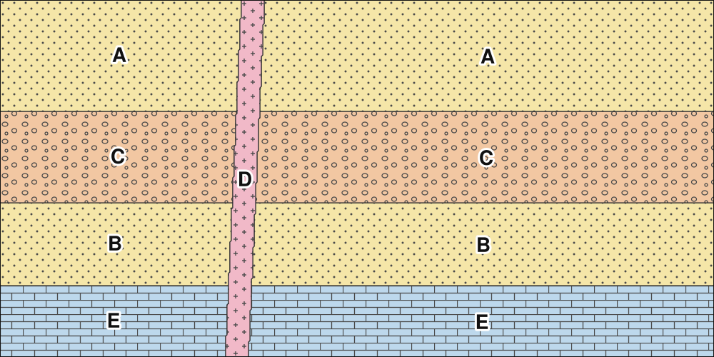
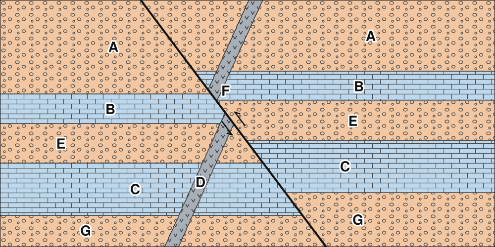
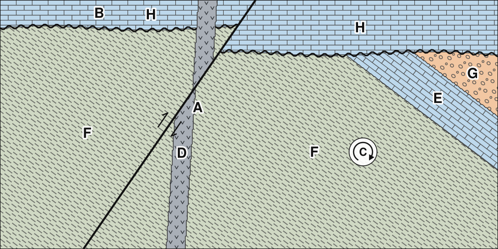

<div align="center">

# GeoHistoria

**Rompecabezas de edad relativa: ordena los eventos de una sección geológica, del más antiguo al más joven.**

**Español** · [English](README.md)

### [▶ Jugar ahora](https://platicandodelatierra.github.io/geohistoria/)

Sin instalación, sin cuenta y sin servidor: todo corre en tu navegador.

</div>

<!-- GIF corto resolviendo un ejercicio: grábalo, guárdalo como docs/geohistoria.gif y quita el comentario de la línea siguiente.

-->

## Ejemplos

¿Puedes ordenarlos? Cada uno se abre en la app, donde puedes revisar tu respuesta.

[](https://platicandodelatierra.github.io/geohistoria/#practica?n=1&s=4)

[](https://platicandodelatierra.github.io/geohistoria/#practica?n=2&s=2)

[](https://platicandodelatierra.github.io/geohistoria/#practica?n=3&s=2)

<details>
<summary>Respuestas, del más antiguo al más joven</summary>

- Nivel 1 (semilla 4): E, B, C, A, D
- Nivel 2 (semilla 2): G, C, E, B, A, D, F
- Nivel 3 (semilla 2): F, E, G, C, B, H, D, A

</details>

Estas figuras se generan con el mismo código de la app (`npm run ejemplos`).

## Qué hace

GeoHistoria dibuja una **sección geológica generada al azar** (capas, fallas, diques, basculamiento y
discordancias). Tú ordenas los eventos del más antiguo al más joven y, al revisar, la app explica **qué
principio** demuestra cada relación: superposición, relaciones de corte, horizontalidad original.

- **Ejercicios infinitos y reproducibles.** Cada sección sale de una *semilla*: la misma semilla da
  siempre la misma sección, así que un ejercicio se comparte con un enlace (`#practica?n=2&s=48213`).
- **Rigor geológico.** Cada sección es geológicamente posible y cada respuesta se puede deducir **solo
  de lo que se ve**. Nunca se exige una relación que no se pueda observar.
- **Aprender, no adivinar.** La retroalimentación marca cada evento en su lugar correcto o incorrecto y
  muestra las evidencias visibles que contradicen tu orden, con su principio y un enlace a la página de
  principios.
- **Estilo de libro de texto.** Colores suaves **más patrones** para cada roca (puntos para arenisca,
  ladrillos para caliza, rayas para lutita, guijarros para conglomerado, cruces y "v" para las ígneas),
  fallas con medias flechas y discordancias onduladas. Funciona en blanco y negro y para personas con
  daltonismo.
- **Accesible.** Las tarjetas se arrastran o se mueven con los botones ↑ ↓ y con el teclado; funciona en
  celulares desde 360 px de ancho. Al pasar el cursor por una tarjeta se resalta su unidad en la sección,
  y al revés.
- Interfaz y explicaciones en **español e inglés**.

### Modos

| Modo | Qué haces |
|---|---|
| **Práctica** | Eliges un nivel, ordenas los eventos, revisas y lees las explicaciones. |
| **Reto diario** | Un ejercicio al día, igual para todos. **Compartir resultado** genera un texto corto que no revela la respuesta. Tu racha se guarda en este navegador. |
| **Profesor** | Hojas de ejercicios y hojas de respuestas separadas, en PDF (ver abajo). |
| **Principios** | Los principios de Steno y Hutton, cada uno con un esquema dibujado por el motor. |

### Niveles

| Nivel | Eventos | Qué aparece | Principios que entrena |
|---|---|---|---|
| 1 | 3–5 | Capas y un dique | Superposición, relaciones de corte |
| 2 | 5–7 | + una falla, hasta dos diques | Corte entre estructuras |
| 3 | 6–9 | + basculamiento, erosión y nuevas capas | Horizontalidad original, discordancia angular |

Los niveles 1 a 3 tienen siempre un **único** orden correcto. El nivel 4 (historias más largas, con dos
ciclos de erosión) está previsto para la versión 1.1.

## Para profesores

<!-- Captura de una hoja del modo profesor: guárdala como docs/hoja-profesor.png y quita el comentario de la línea siguiente.

-->

1. Abre el [modo **Profesor**](https://platicandodelatierra.github.io/geohistoria/#profesor).
2. Elige el nivel, la cantidad de ejercicios (1 a 20), la primera semilla (al azar si la dejas vacía) y
   el papel (carta o A4).
3. Descarga la **hoja de ejercicios** y la **hoja de respuestas**, dos PDF separados. La hoja de
   respuestas trae el orden correcto de cada ejercicio y todas las evidencias visibles, con su principio.

Las semillas son consecutivas a partir de la primera, así que **el mismo enlace da siempre la misma
hoja**: usa **Copiar enlace de esta hoja** para compartirla con otro grupo o volver a usarla el próximo
semestre. Cada ejercicio de la hoja lleva su semilla y un enlace para resolverlo en línea.

Para usar una sección en tus presentaciones, usa **Descargar SVG** o **Descargar PNG** en el modo
Práctica.

## Cómo funciona el motor

- **Una historia es una lista de eventos**: depósito, basculamiento, falla, dique y erosión, con
  espesores, ángulos y echados realistas.
- **Modelo implícito.** Para saber qué unidad hay en un punto *hoy*, el motor recorre los eventos del más
  joven al más antiguo y deshace cada uno (deshace la falla, el basculamiento…). La sección se muestrea en
  una cuadrícula y se convierte en polígonos con [d3-contour](https://github.com/d3/d3-contour).
- **Solo cuenta lo que se ve.** Las relaciones se leen de la sección dibujada, no de la lista de eventos:
  dos capas en contacto, un dique que corta una capa, una falla que desplaza un dique, una superficie que
  trunca capas inclinadas. Cada una se vuelve una arista "A es más antiguo que B" con su principio y una
  explicación en español e inglés.
- **Un solo orden.** La respuesta correcta es cualquier orden compatible con esas relaciones. El
  generador solo acepta secciones con orden único, donde todo evento sea visible y ninguna unidad sea una
  astilla imposible de leer; si no, lo intenta otra vez con la siguiente subsemilla.
- **Prueba masiva**: 2,000 semillas por nivel, cada una revisada con todas las reglas.

## Cómo citar

Si usas GeoHistoria en tus clases o en una publicación, cítala así:

> Torres Sánchez, D. (2026). *GeoHistoria* (versión 1.0.0) [software].
> https://github.com/PlaticandodelaTierra/geohistoria

El repositorio incluye un archivo [`CITATION.cff`](CITATION.cff), así que el botón **Cite this
repository** de GitHub da la cita en APA y BibTeX. El DOI de Zenodo se agregará con la primera versión
publicada.

## Otras herramientas del autor

- [**GeoEscala**](https://platicandodelatierra.github.io/geoescala/): barras de la escala del tiempo
  geológico con las edades y los colores oficiales de la ICS, listas para tus figuras.
  ([repositorio](https://github.com/PlaticandodelaTierra/geoescala))
<!-- Agregar el enlace a BIRDS cuando sea público. -->
- **B.I.R.D.S — Broad Igneous Rocks: Diagrams & Statistics.** Aplicación de escritorio para graficar,
  clasificar y analizar datos geoquímicos de roca total de rocas ígneas.

## Desarrollo

Requiere [Node.js](https://nodejs.org/) 26 (ver [`.nvmrc`](.nvmrc)).

```bash
npm install
```

```bash
npm run dev
```

```bash
npm test
```

```bash
npm run build
```

- `npm run test:masiva` corre la prueba masiva del generador (2,000 semillas por nivel; tarda varios
  minutos) y guarda sus informes en `informes/`.
- `npm run ejemplos` vuelve a generar las figuras de ejemplo de `docs/ejemplos/`.
- Con `npm run dev` están disponibles las páginas de desarrollo `#generador` (12 secciones generadas a
  la vez, con su semilla) y `#ejemplos` (las secciones hechas a mano con sus evidencias). No se publican.
- Cada push a `main` corre las pruebas y publica el sitio en GitHub Pages
  ([`.github/workflows/deploy.yml`](.github/workflows/deploy.yml)).

## Licencia

[MIT](LICENSE). Los patrones de roca y todos los dibujos son del proyecto; la app no usa datos externos
ni hace llamadas a internet.

---

Darío Torres Sánchez · Platicando de la Tierra
