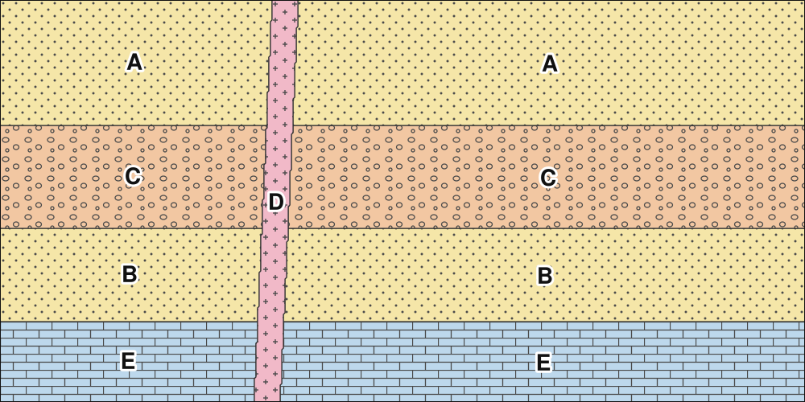
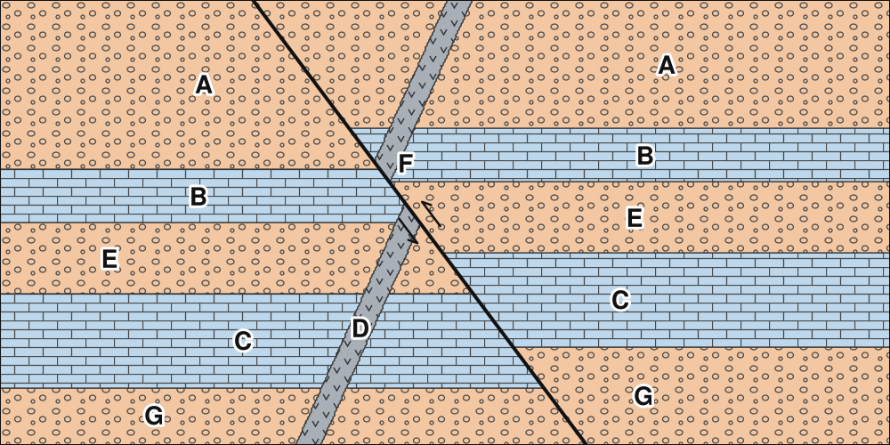
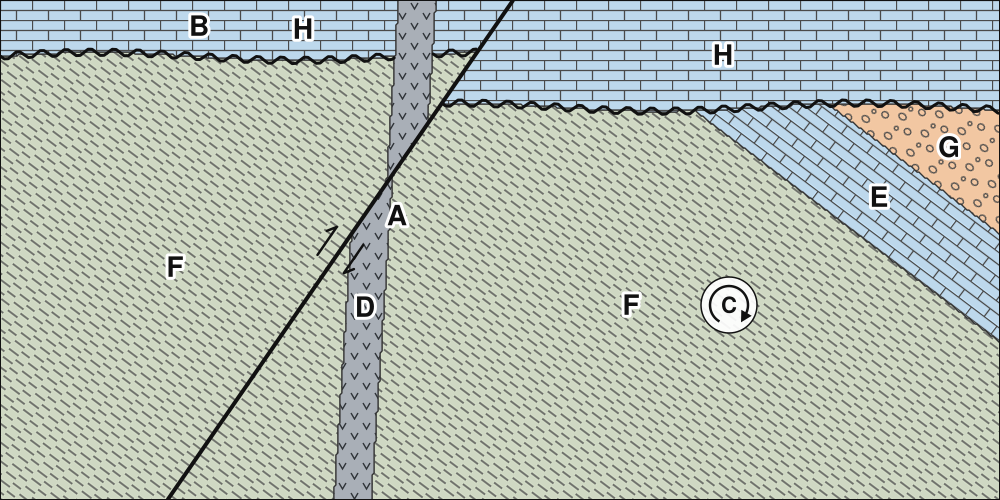

<div align="center">

# GeoHistoria

**Relative-age puzzles: put the events of a geologic cross-section in order, from oldest to youngest.**

[Español](README.es.md) · **English**

### [▶ Play now](https://platicandodelatierra.github.io/geohistoria/)

No installation, no account, no server: everything runs in your browser.

</div>

<!-- Short GIF solving an exercise: record it and save it as docs/geohistoria.gif, then uncomment the next line.

-->

## Examples

Can you put them in order? Each one opens in the app, where you can check your answer.

[](https://platicandodelatierra.github.io/geohistoria/#practica?n=1&s=4)

[](https://platicandodelatierra.github.io/geohistoria/#practica?n=2&s=2)

[](https://platicandodelatierra.github.io/geohistoria/#practica?n=3&s=2)

<details>
<summary>Answers, from oldest to youngest</summary>

- Level 1 (seed 4): E, B, C, A, D
- Level 2 (seed 2): G, C, E, B, A, D, F
- Level 3 (seed 2): F, E, G, C, B, H, D, A

</details>

These figures are generated with the same code as the app (`npm run ejemplos`).

## What it does

GeoHistoria draws a **randomly generated geologic cross-section** (layers, faults, dikes, tilting and
unconformities). You order the events from oldest to youngest, and when you check your answer the app
explains **which principle** proves each relationship: superposition, cross-cutting relationships,
original horizontality.

- **Endless and reproducible exercises.** Each section comes from a *seed*: the same seed always gives
  the same section, so an exercise can be shared with a link (`#practica?n=2&s=48213`).
- **Geological rigor.** Every section is geologically possible, and every answer can be deduced **only
  from what you see**. A relationship that cannot be observed is never required.
- **Learn, don't guess.** The feedback marks each event in its right or wrong place and lists the
  visible evidence that contradicts your order, with its principle and a link to the principles page.
- **Textbook style.** Soft colors **plus patterns** for each rock type (dots for sandstone, bricks for
  limestone, dashes for shale, pebbles for conglomerate, crosses and v's for igneous rocks), faults
  with half arrows, wavy unconformities. It works in black and white and for people with color vision
  deficiency.
- **Accessible.** Cards can be dragged or moved with ↑ ↓ buttons and the keyboard; it works on phones
  from 360 px wide. Hovering over a card highlights its unit in the section, and vice versa.
- **Spanish and English** interface and explanations.

### Modes

| Mode | What you do |
|---|---|
| **Practice** | Choose a level, order the events, check your answer and read the explanations. |
| **Daily challenge** | One exercise per day, the same for everyone. **Share result** gives a short text that does not reveal the answer. Your streak is saved in this browser. |
| **Teacher** | Exercise sheets and separate answer keys in PDF (see below). |
| **Principles** | Steno's and Hutton's principles, each with a diagram drawn by the engine. |

### Levels

| Level | Events | What appears | Principles it trains |
|---|---|---|---|
| 1 | 3–5 | Layers and one dike | Superposition, cross-cutting relationships |
| 2 | 5–7 | + a fault, up to two dikes | Cross-cutting between structures |
| 3 | 6–9 | + tilting, erosion and new layers | Original horizontality, angular unconformity |

Levels 1–3 always have a **single** correct order. Level 4 (longer histories with two erosion cycles) is
planned for version 1.1.

## For teachers

<!-- Screenshot of a teacher sheet: save it as docs/hoja-profesor.png, then uncomment the next line.

-->

1. Open the [**Teacher** mode](https://platicandodelatierra.github.io/geohistoria/#profesor).
2. Choose the level, the number of exercises (1 to 20), the first seed (random if you leave it empty)
   and the paper size (Letter or A4).
3. Download the **exercise sheet** and the **answer key**, two separate PDFs. The key gives the correct
   order of each exercise and every piece of visible evidence with its principle.

Seeds are consecutive from the first one, so **the same link always gives the same sheet**: use
**Copy link to this sheet** to share it with another group or to reuse it next term. Each exercise on
the sheet carries its seed and a link to solve it online.

To use a section in your slides, **Download SVG** or **Download PNG** in Practice mode.

## How the engine works

- **A history is a list of events**: deposition, tilting, faulting, dike intrusion and erosion, each
  with realistic thicknesses, angles and dips.
- **Implicit model.** To know which unit is at a point *today*, the engine walks the events from youngest
  to oldest and undoes each one (unfaults, untilts…). The section is sampled on a grid and turned into
  polygons with [d3-contour](https://github.com/d3/d3-contour).
- **Only what is visible counts.** The relationships are read from the drawn section, not from the list
  of events: two layers in contact, a dike that cuts a layer, a fault that offsets a dike, a surface
  that truncates tilted layers. Each one becomes an edge “A is older than B” with its principle and an
  explanation in Spanish and English.
- **A single order.** The correct answer is any order compatible with those relationships. The generator
  keeps only sections whose order is unique, where every event is visible and no unit is a sliver too
  small to read; otherwise it tries again with the next sub-seed.
- **Tested in bulk**: 2,000 seeds per level, each one checked against all the rules.

## How to cite

If you use GeoHistoria in your teaching or in a publication, please cite it:

> Torres Sánchez, D. (2026). *GeoHistoria* (version 1.0.0) [software].
> https://github.com/PlaticandodelaTierra/geohistoria

The repository includes a [`CITATION.cff`](CITATION.cff) file, so GitHub's **Cite this repository**
button gives the citation in APA and BibTeX. A Zenodo DOI will be added with the first release.

## Other tools by the author

- [**GeoEscala**](https://platicandodelatierra.github.io/geoescala/): geologic time scale bars with the
  official ICS ages and colors, ready for your figures.
  ([repository](https://github.com/PlaticandodelaTierra/geoescala))
<!-- Add the link to BIRDS when it is public. -->
- **B.I.R.D.S — Broad Igneous Rocks: Diagrams & Statistics.** A desktop application for plotting,
  classifying and analysing whole-rock geochemical data of igneous rocks.

## Development

Requires [Node.js](https://nodejs.org/) 26 (see [`.nvmrc`](.nvmrc)).

```bash
npm install
```

```bash
npm run dev
```

```bash
npm test
```

```bash
npm run build
```

- `npm run test:masiva` runs the bulk generator test (2,000 seeds per level; it takes several
  minutes) and writes its reports to `informes/`.
- `npm run ejemplos` regenerates the example figures in `docs/ejemplos/`.
- With `npm run dev`, the development pages `#generador` (12 generated sections at once, with their
  seeds) and `#ejemplos` (the hand-made sections with their evidence) are available. They are not
  published.
- Every push to `main` runs the tests and publishes the site to GitHub Pages
  ([`.github/workflows/deploy.yml`](.github/workflows/deploy.yml)).

## License

[MIT](LICENSE). The rock patterns and all the drawings are made by the project; the app uses no
external data and makes no calls to the internet.

---

Darío Torres Sánchez · Platicando de la Tierra
